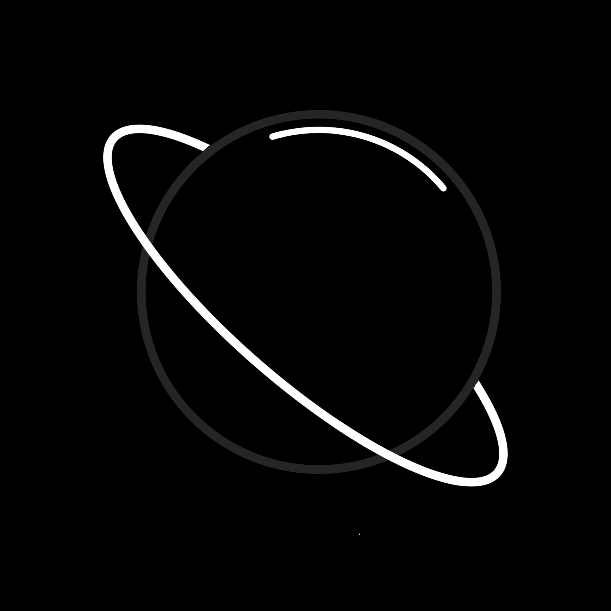

# jawhar: kernel

  

  
## • Overview
jawhar is a modern monolithic kernel written in Rust and assembly.
Core planning: the pipes will be labeled with Rust.

## • Documentation
Kernel documentation lives in [`doc/`](doc/README.md): build and boot,
architecture support, assembly, system calls, processes, memory, time, drivers
and libraries. Run `make docs` to list the pages.
